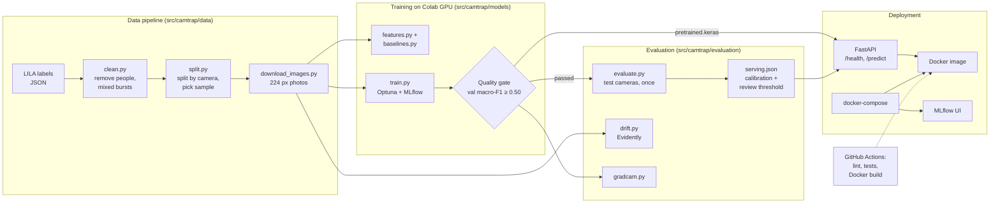

# Site-Robust Camera-Trap Species Classification

[](https://github.com/DianaAdhiambo1809/camtrap-species-classifier/actions/workflows/ci.yml)

Camera traps in East African parks take far more photos than people can review, and most
of those photos are empty. This project builds a service that filters out empty frames,
identifies the species in the rest, and flags uncertain predictions for a person to check.
The model is evaluated on camera sites it never saw during training, because that is how
it would be used in practice.

**Course:** DSA 8401 Applied Machine Learning, Strathmore University
**Author:** Diana Adhiambo Owuoth (093481)
**Data:** [Snapshot Serengeti](https://lila.science/datasets/snapshot-serengeti), Season 1, via LILA BC (CDLA-Permissive-1.0)

## Contents

1. [The data at a glance](#the-data-at-a-glance-season-1)
2. [Architecture](#architecture)
3. [Results](#results)
4. [Reproducing the project](#reproducing-the-project)
5. [Using the API](#using-the-api)
6. [Project layout](#project-layout)

## The data at a glance (Season 1)

| | |
|---|---|
| Photos / bursts / cameras | 411,414 / 148,226 / 168 |
| Empty bursts | 82.7% |
| Bursts after cleaning | 145,831 |
| Classes | 12 species + `other` + `empty` |
| Split by camera (train / val / test) | 117 / 26 / 25 cameras |
| Photos used for modelling | 8,068 (one per burst) |

The full audit, including the missing-data analysis (MCAR / MAR / MNAR), is in
[`notebooks/01_data_audit.ipynb`](notebooks/01_data_audit.ipynb).

## Architecture



Three choices run through the whole design:

- **Split by camera, never by photo.** Photos from one camera share the background, so a
  random split lets a model recognise the place instead of the animal. With the baseline,
  a random split scored 0.72 macro-F1 against 0.58 for a camera split.
- **Macro-F1 as the main metric.** Every class counts equally, so the rare species matter as
  much as the common ones. Accuracy is misleading here: always answering "empty" gives 90%.
- **The test cameras are used once.** Models and settings are chosen on the validation
  cameras; the test cameras are only scored at the end.

## Results

All scores are on cameras the models never saw in training.

| Model | Validation macro-F1 | Test macro-F1 | Test accuracy |
|---|---|---|---|
| Dummy (always "empty"), all validation bursts | 0.068 | | 0.902 |
| Logistic regression on pretrained features | 0.560 | 0.586 | 0.596 |
| CNN from scratch (Lab 7 design, Optuna) | 0.132 | 0.148 | 0.171 |
| **EfficientNetB0 fine-tuned (Optuna), final model** | **0.586** | **0.598** | **0.610** |

Main findings on the test cameras (final model):

- **95% interval for macro-F1: 0.53 to 0.63**, from resampling whole cameras (bootstrap).
- **No drop on new cameras:** test macro-F1 is 0.01 *higher* than validation.
- **Night is harder:** macro-F1 0.40 at night against 0.58 by day.
- **Hardest classes:** `other` (0.24), reedbuck (0.33, only 26 test photos) and `empty` (0.45).
  Best: giraffe (0.77).
- **The CNN from scratch memorised the training cameras:** training accuracy reached 48%
  while validation stayed below 20%. It failed the quality gate and is not used.
- **Human review:** photos below a calibrated confidence of 0.87 go to a person. That is 60%
  of photos; the 40% accepted automatically are 92% correct. The cost per 100 photos is 76,
  against 100 for checking everything and 195 for accepting everything unchecked
  (a wrong label costs 5 times a review).
- **Drift between training and test cameras** (Evidently): small. Brightness, contrast,
  colour and time of day are stable; the share of green (vegetation) differs most.

Figures are in [`reports/figures/`](reports/figures/), numbers in
[`reports/results/`](reports/results/) and the drift report in
[`reports/drift_report.html`](reports/drift_report.html). The full discussion is in the final report.

## Reproducing the project

### 1. Setup

Python 3.10 or later.

```powershell
python -m venv .venv
.venv\Scripts\Activate.ps1
pip install -r requirements.txt
pip install -e .
```

### 2. Run the steps

Every setting lives in [`configs/config.yaml`](configs/config.yaml). Run the steps in order
from the project folder. Steps 4 to 7 need a GPU and were run on Google Colab with
[`notebooks/colab_run.ipynb`](notebooks/colab_run.ipynb), which clones this repository and
calls the same commands.

| Step | Command | Output |
|---|---|---|
| 1. Download the labels | `python -m camtrap.data.download` | `data/raw/` |
| 2. Clean | `python -m camtrap.data.clean` | `data/processed/bursts.csv` |
| 3. Split by camera and pick the sample | `python -m camtrap.data.split` | `data/processed/sample.csv` |
| 4. Download and resize the photos (about 5 GB) | `python -m camtrap.data.download_images` | `data/images/<split>/<class>/` |
| 5. Pretrained image features | `python -m camtrap.models.features` | `data/processed/features.npz` |
| 6. Train both CNNs with Optuna | `python -m camtrap.models.train --model scratch`<br/>`python -m camtrap.models.train --model pretrained` | `models/`, `mlflow.db` |
| 7. Predict validation and test photos | `python -m camtrap.models.predict` | `reports/results/predictions_*.csv` |
| 8. Baselines | `python -m camtrap.models.baselines` | `reports/results/baselines.csv` |
| 9. Evaluate on the test cameras | `python -m camtrap.evaluation.evaluate` | `reports/results/test_*`, `models/serving.json` |
| 10. Drift report | `python -m camtrap.evaluation.drift` | `reports/drift_report.html` |
| 11. Grad-CAM and date-strip check (GPU) | `python -m camtrap.evaluation.gradcam` | `reports/figures/gradcam_*.png` |

No data is stored in this repository; the pipeline recreates it. The final model
(`models/pretrained.keras`, 26 MB) and the MLflow runs (`mlflow.db`) are committed so the
API can run without retraining.

### 3. Tests

```powershell
pytest
```

The API tests use a small fake model, so they run in seconds without TensorFlow.
GitHub Actions runs the linter and the tests, then builds the Docker image and checks that it
starts, on every push.

## Using the API

Start the API and the MLflow dashboard with Docker:

```powershell
docker compose up --build
```

| Address | What it is |
|---|---|
| http://localhost:8000/docs | API, with a page to try it in the browser |
| http://localhost:5000 | MLflow: every Optuna trial and final training run |

Without Docker: `uvicorn camtrap.serving.app:app` (needs `requirements-api.txt`).

Send a photo:

```powershell
curl -X POST http://localhost:8000/predict -F "file=@photo.jpg"
```

The answer looks like this (example values):

```json
{
  "species": "giraffe",
  "confidence": 0.9412,
  "calibrated_confidence": 0.9655,
  "needs_review": false,
  "review_threshold": 0.8651,
  "top_3": [
    {"species": "giraffe", "probability": 0.9412},
    {"species": "elephant", "probability": 0.0231},
    {"species": "other", "probability": 0.0118}
  ],
  "model": "pretrained"
}
```

`needs_review` is `true` when the calibrated confidence is below the threshold chosen on
the validation cameras; those photos should be checked by a person. The API only loads a
model that passed the quality gate (validation macro-F1 ≥ 0.50).

## Project layout

```
.github/workflows/   CI: lint, tests, Docker build
configs/             every setting (config.yaml)
notebooks/           01_data_audit.ipynb, colab_run.ipynb
src/camtrap/
  data/              download, cleaning, camera split, photo download
  models/            features, baselines, CNN training, prediction
  evaluation/        test evaluation, drift report, Grad-CAM
  serving/           FastAPI service
tests/               API tests
models/              final model, settings, calibration (serving.json)
reports/             figures, results, drift report, final report and slides
Dockerfile, docker-compose.yml, requirements-api.txt   deployment
data/                created by the pipeline (not committed)
```

## AI assistance

See [`AI_USE.md`](AI_USE.md).
